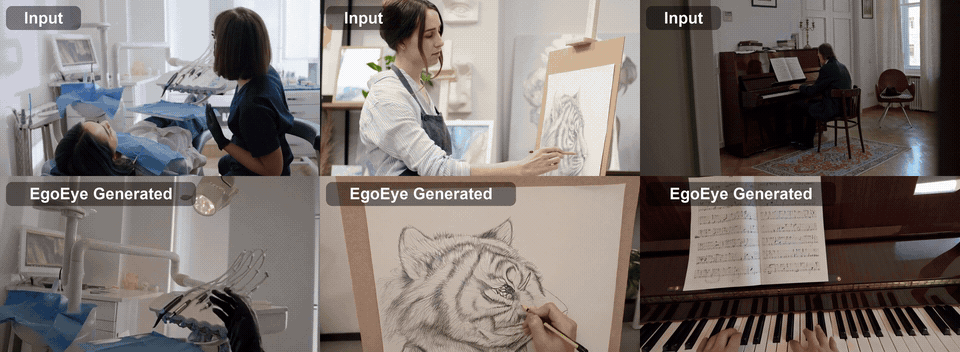

<div align="center">
  <h1>EgoEye: Seeing the World through Any Eyes</h1>
  <p><strong>NeurIPS 2026</strong></p>
  <p>
    <a href="https://www.yangfu.site/" target="_blank" rel="noreferrer">Yang Fu</a>
    &nbsp;·&nbsp;
    Wang Jianqin
    &nbsp;·&nbsp;
    Xiangtai Li
    &nbsp;·&nbsp;
    <a href="https://henghuiding.com/" target="_blank" rel="noreferrer">Henghui Ding</a>†
  </p>
  <p>
    Institute of Big Data, College of Computer Science and Artificial Intelligence, Fudan University, China
    <br />
    † Corresponding author
  </p>
  <div>
    <h4 align="center">
      <a href="https://henghuiding.com/EgoEye/" target="_blank" rel="noreferrer">
        
      </a>
      <a href="https://huggingface.co/FudanCVL/EgoEye" target="_blank" rel="noreferrer">
        
      </a>
      <a href="https://huggingface.co/datasets/FudanCVL/EgoEye" target="_blank" rel="noreferrer">
        
      </a>
      <a href="https://huggingface.co/datasets/FudanCVL/EgoEval" target="_blank" rel="noreferrer">
        
      </a>
    </h4>
  </div>
  EgoEye generates first-person (egocentric) videos from third-person (exocentric) videos.
  <br />
  For more visual results, check out our <a href="https://henghuiding.com/EgoEye/" target="_blank" rel="noreferrer">project page</a>.
</div>

---

## Result



## Quick Start

1. Download weights

   ```bash
   # LoRA checkpoints
   hf download FudanCVL/EgoEye qwen_lora.ckpt wan22_lora.ckpt qwen_lora/adapter_config.json --local-dir weights

   # Base models
   hf download Wan-AI/Wan2.2-TI2V-5B-Diffusers --local-dir /tmp/egoeye_models/wan22
   hf download Qwen/Qwen3-VL-32B-Instruct --local-dir /tmp/egoeye_models/qwen3vl
   ```

2. Run inference

   ```bash
   # One-stage inference (subjects.csv columns: tpv,prompt)
   CUDA_VISIBLE_DEVICES=0 python scripts/infer.py \
     --stage one \
     --video-root /path/to/TPV \
     --subject-csv subjects.csv \
     --qwen-python /path/to/qwen/environment/bin/python \
     --output outputs/one_stage

   # Two-stage inference (for custom prompts, omit --benchmark and pass a CSV with tpv,prompt columns)
   CUDA_VISIBLE_DEVICES=0 python scripts/infer.py \
     --stage two --benchmark EgoEval \
     --video-root /path/to/EgoEval/TPV \
     --prompt-csv prompts/EgoEval/PROMPT.csv \
     --output outputs/two_stage
   ```

   Use `--wan-model` and `--qwen-model` to override default model paths. Generated videos are saved to `outputs/<run>/videos/`.

## BibTeX

Please consider to cite:

```bibtex
@inproceedings{fu2026egoeye,
  title={{EgoEye}: Seeing the World through Any Eyes},
  author={Fu, Yang and Wang, Jianqin and Li, Xiangtai and Ding, Henghui},
  booktitle={Advances in Neural Information Processing Systems (NeurIPS)},
  year={2026}
}
```

## Contact

If you have any questions, please feel free to reach me out at aleeyanger@gmail.com.

## Acknowledgement

This code is based on [Wan2.2](https://github.com/Wan-Video/Wan2.2) and [Qwen3-VL](https://github.com/QwenLM/Qwen3-VL). Thanks for their awesome works!

## License

This project is licensed under CC BY-NC 4.0.

For research purposes only. Commercial use is strictly prohibited.
